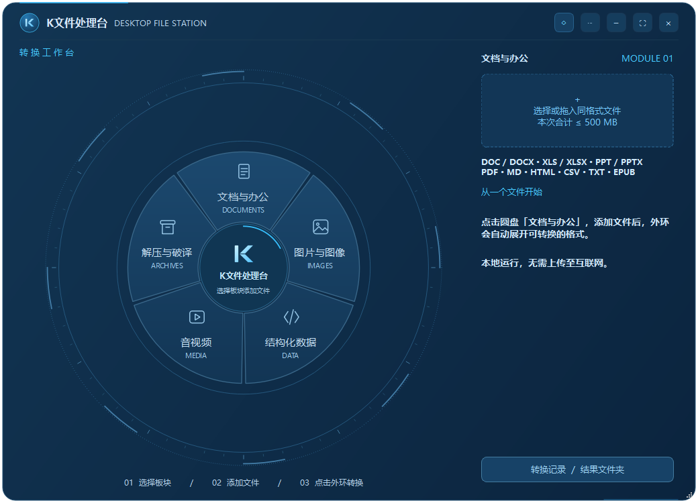
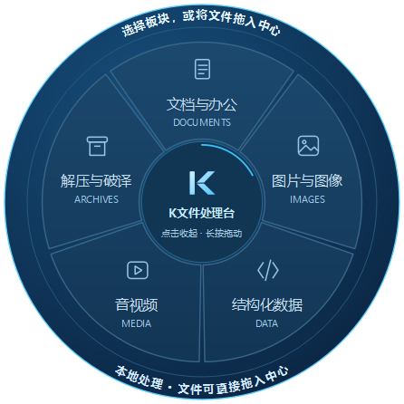

# K文件处理台

**K File Station 1.0.0** · Windows 10 / 11 x64 · 本地处理 · 便携运行

一个可以悬浮在桌面、自由拖动的蓝色科技风文件处理工具。通过圆形工作台或矩形窗口，完成文档、图片、结构化数据、音视频转换，以及压缩包解压与密码恢复，目前本版本支持35种不同文件格式间的92条转换关系。

[下载 Windows 便携版](https://github.com/ykiii5277-web/K-File-Station/releases/tag/v1.0.0) · [全部发行版本](https://github.com/ykiii5277-web/K-File-Station/releases) · [反馈问题](https://github.com/ykiii5277-web/K-File-Station/issues)



## 下载与启动

1. 在 Releases 下载 `K-File-Station-v1.0.0-Windows-x64.zip`，解压到可写目录。
2. 双击解压目录中的 `K文件处理台.exe`。无需另装 Python、Office 或转换引擎。
3. 迁移到其他电脑时复制整个便携文件夹；需要保留结果、设置和搜索进度时，一并保留 `data`。

`SHA256.txt` 提供便携包校验值。不要直接在压缩包中运行 EXE。

## 使用方式

- 点按圆形 K Logo 打开圆形工作台，长按约半秒打开矩形窗口；按下立即拖动可移动 Logo。
- 圆形工作台长按约三分之一秒可拖动，鼠标经过板块时点亮并突出。点击板块选择文件，或直接拖入中心，自动识别后展开格式环。
- 点击外环或右侧目标格式开始转换。矩形窗口显示科技数字百分比，圆形工作台显示从顶部顺时针推进的激光光圈。
- 矩形窗口支持拖动、自由缩放及 F11 全屏。Esc 先退出全屏，再收起挂件；菜单可切换窗口置顶、打开结果、修改选项和退出。
- 右键「使用说明」打开独立窗口。详细说明含六个一级目录、24个二级目录，初始全部折叠。



## 五个板块

| 板块 | 功能 |
| --- | --- |
| 文档与办公 | 新旧 Office、PDF、Markdown、HTML、TXT、EPUB，扫描页中英文 OCR、表格提取 |
| 图片与图像 | 常用位图、AVIF、HEIC、RAW、SVG、动画、ICO 输出、多图合并 PDF |
| 结构化数据 | JSON、JSONL、YAML、XML、CSV、TSV，以及 JSON 与 XLSX 互转 |
| 音视频 | 视频封装与转码、音轨提取、音频转换、MP4 截取 GIF |
| 解压与破译 | ZIP、RAR、7z、TAR 系列解压，已知候选、字典、规律、快速及深度密码搜索 |

支持单次最多100个同格式文件；别名如 JPEG/JPG、TIF/TIFF 视为相同格式，不同 RAW 后缀不可混选。单次所选文件合计：办公、图片、结构化数据各500 MB，音视频2 GB，压缩包5 GB，按1024进制计算。

批量转换顺序执行并将结果打包 ZIP；同格式多张 JPG/PNG 转 PDF 默认合并，也可取消合并。部分失败时保留成功结果并附失败说明。

## 转换关系


当前共92条直接转换方向，解压操作不计入。仅支持下表列出的方向，不能任意互转。

| 输入 | 可直接转换为 |
| --- | --- |
| DOC | DOCX、PDF、MD、TXT |
| DOCX | DOC、MD、PDF、TXT |
| MD | DOCX、HTML、PDF |
| HTML | MD、EPUB、PDF |
| PDF | DOCX、TXT、XLSX、PNG |
| XLS | XLSX、PDF、CSV |
| XLSX | XLS、PDF、CSV、JSON |
| PPT | PPTX、PDF |
| PPTX | PPT、PDF |
| CSV | XLSX、JSON、TSV |
| JSON | YAML、XML、CSV、XLSX、JSONL |
| YAML | JSON |
| XML | JSON |
| MP4 | WEBM、MKV、MOV、M4A、AAC、MP3、WAV、GIF |
| WEBM | MP4、MP3、WAV |
| MKV | MP4、MP3、WAV |
| MOV | MP4、MP3、WAV |
| WAV | M4A、AAC、MP3、FLAC |
| FLAC | WAV |
| TXT | DOCX、PDF |
| EPUB | DOCX、HTML |
| JPG | PNG、PDF、AVIF |
| PNG | JPG、TIFF、WEBP、ICO、PDF、AVIF |
| TIFF | PNG |
| WEBP | PNG、JPG |
| RAW | JPG、TIFF |
| HEIC | JPG、PNG |
| SVG | PNG |
| GIF | MP4 |
| AVIF | JPG、PNG |
| MP3 | WAV |
| M4A | MP3、WAV |
| AAC | MP3、WAV |
| JSONL | JSON |
| TSV | CSV |


## 解压与密码恢复

无密码压缩包识别后直接解压，有密码则打开独立搜索窗口。支持自动快速/深度、字符组合、预设字符集、手动候选、TXT字典、密码规律和未知长度补齐。搜索可停止并续接未完成任务，结果默认显示，可选择找到密码后自动解压。

分卷放在同一目录，仅选择第一卷。TAR.GZ/TGZ、TAR.XZ/TXZ直接解到最终文件。批量压缩包无密码时自动继续，加密包完成后点击「下一个」。本工具不提供 ZIP/7z 创建或重新打包。

搜索范围和执行顺序见 [快速与深度搜索](docs/搜索范围与顺序.md)。密码恢复取决于所选范围、密码复杂度及设备能力，不保证任意密码均可恢复。

## 保存与内容限制

结果默认保存到 `data/outputs`，解压可另选目录。原文件保留，移除当前文件不会删除已生成结果。界面计数表示本次运行完成的任务。

PDF最多500页；现代Office/EPUB内部合计最多300 MB/10000项；图片单帧8000万像素、总3.2亿像素、最多5000帧；结构化数据最多80层/10万节点；音视频最长24小时，单次编码上限约30分钟；GIF截取最长30秒。完整参数和转换效果说明见工具内详细说明。

文件在本机处理，无需账号或上传互联网。`data`中包含输入副本、结果、日志、设置和搜索记录；公开源码和发行包均排除此目录。

## 从源码运行与构建

使用 **Windows x64 + Python 3.13**。源码仓库不存放体积较大的转换引擎和运行库，可从便携 Release 恢复引擎。

```powershell
python -m venv .venv
.\.venv\Scripts\python.exe -m pip install -r requirements-lock.txt
.\.venv\Scripts\python.exe tools/prepare_engines.py --download
.\.venv\Scripts\python.exe app.py
```

已下载便携包时，可用 `tools/prepare_engines.py --archive <便携包路径>` 导入引擎。压缩包恢复核心由Python 3.13编译组件提供，适配器和界面源码在本仓库；重编译恢复核心本身需要其原始源码。

```powershell
.\.venv\Scripts\python.exe -m pytest --ignore=tests/test_desktop.py -q
.\.venv\Scripts\python.exe app.py --check-widget --report-dir build/native-check
.\.venv\Scripts\python.exe app.py --check-archives --report-dir build/archive-check
.\.venv\Scripts\python.exe app.py --check-extra --report-dir build/conversion-check
.\.venv\Scripts\python.exe tools/build_portable.py --no-zip
.\.venv\Scripts\python.exe tools/package_release.py
.\.venv\Scripts\python.exe tools/verify_release.py
```

测试使用合成文件及已知密码夹具。[版本说明](docs/版本说明-v1.0.0.md)与[验证记录](docs/验证-v1.0.0.md)说明发行范围和验证依据。`--browser`提供兼容单文件浏览器模式，完整批量及解压功能使用原生界面。

## 许可与第三方组件

应用与适配器代码采用 **AGPL-3.0-or-later**，见 [LICENSE.txt](LICENSE.txt)。各第三方引擎保留原始许可，详见 [THIRD_PARTY_NOTICES.md](THIRD_PARTY_NOTICES.md)、[引擎来源](docs/引擎来源.md)和[图片与音视频组件](docs/图片引擎来源.md)。
